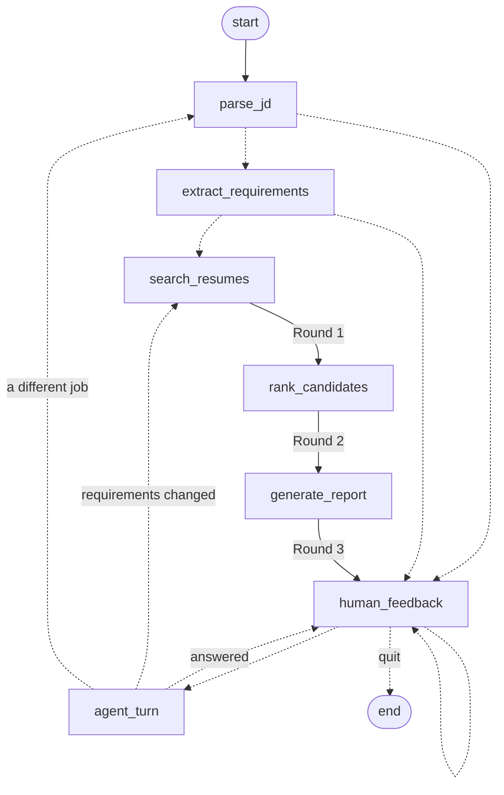

# Agentic Profile Matching

A LangGraph agent that screens 100 resumes for a job in three rounds and then talks it over
with the recruiter. Ask it in plain English for "candidates with React and 3+ years
experience", compare the matches, ask why one outranks another, change the requirements
halfway through, and it re-screens and tells you who moved and why.

```bash
uv venv --python 3.12 .venv && VIRTUAL_ENV=.venv uv pip install -r requirements-dev.txt
cp .env.example .env            # then add your ANTHROPIC_API_KEY
.venv/bin/python scripts/build_index.py   # build the Round 1 index once (local MiniLM by default)
.venv/bin/python chat.py        # talk to the agent
.venv/bin/python -m pytest      # 208 tests, offline, a few seconds
```

## Deliverables

| The brief asks for | Where it is |
|---|---|
| LangGraph agent in `matching_agent.py` | [`matching_agent.py`](matching_agent.py): state, seven nodes, routing |
| State machine diagram | [`docs/state_machine.md`](docs/state_machine.md), drawn from the compiled graph; also below |
| Chat interface | [`chat.py`](chat.py), a terminal chat |
| Test scenarios, 5+ conversation flows | [`tests/test_conversation_flows.py`](tests/test_conversation_flows.py) (17 flow tests, offline) and [`scenarios/`](scenarios/) (6 flows run against the real model, transcripts in [`scenarios/transcripts/`](scenarios/transcripts/)) |
| Demo video, 5-6 minutes | [`demo/demo.mp4`](demo/demo.mp4), a recorded live session with captions, 5:32 |
| Tools: Milestone 1 file tools, Milestone 2 RAG search, `extract_requirements`, `compare_candidates`, `generate_interview_questions` | [`agent_tools.py`](agent_tools.py), twelve tools in all |
| 100 resumes | [`resumes/`](resumes/): Milestone 2's 43 plus 57 generated, described in [`DATASET.md`](DATASET.md) |

If you read one more file, make it [`docs/walkthrough.md`](docs/walkthrough.md): it follows
one chat message from the terminal, through the graph, the tool schema, the tool call and
the file operations, to Claude's final answer.

## How it works



Dashed edges are decided at run time by the node's result. The exact diagram LangGraph
draws from the compiled graph is in [`docs/state_machine.md`](docs/state_machine.md)
(`python matching_agent.py --diagram` regenerates it).

**The pipeline** is the brief's: Parse JD, Extract Requirements, Search Resumes, Rank
Candidates, Generate Report, then a human feedback loop.

| Node | Round | What it does |
|---|---|---|
| `parse_jd` | | Takes pasted text, a one-line request, or a file path read with Milestone 1's `read_file` |
| `extract_requirements` | | Claude splits it into must-haves and nice-to-haves, and says what it assumed where the request was ambiguous |
| `search_resumes` | 1 | Milestone 2's hybrid RAG search (embeddings in ChromaDB, BM25, skill match) ranks all 100 resumes; the top 10 go on |
| `rank_candidates` | 2 | Claude reads each of the 10 and judges every requirement as **met**, **partial** or **missing**, quoting the resume; ten resumes are judged in parallel |
| `generate_report` | 3 | Hire / borderline / no hire, improvement suggestions for borderline candidates, a Markdown and a JSON report in `reports/` |
| `human_feedback` | | LangGraph `interrupt()`: the graph pauses until the recruiter replies |
| `agent_turn` | | Claude answers with tools, and may send the graph back to re-screen or start over |

**The score is a formula, not a model output.** Claude's only judgement is per requirement
(met / partial / missing, with a quote). [`screening.py`](screening.py) turns those into a
fit score (must-haves count double, partial counts half), a ranking, and a recommendation
decided by the must-haves alone: every must-have met is *Hire*, any missing is *No hire*,
anything in between is *Borderline*. Because it is a formula, "why did A rank above B?" has
an exact answer: the requirements where their judgements differ.

**Quotes are checked.** Every quote Claude gives as evidence is looked up in the resume,
word by word (so a quote that runs across a bullet or a line break still matches, and
"Java" is never found inside "JavaScript"). A quote must be at least three words, and may
skip text with "..." only within one passage. A "met" whose quote cannot be found counts
only as partial and is flagged in the report, so an invented qualification cannot carry a
candidate to *Hire*.

**Nothing is guessed.** If Claude cannot judge a resume (a refusal, or an answer that
cannot be read), that candidate is left out of the round and named in the summary, and the
next re-screen tries again. A requirement Claude skips is asked again on its own; it is
never filled in as "missing". Reports are never overwritten: each round gets a new file.

### Tools

| Group | Tools |
|---|---|
| Milestone 1 file tools | `list_files`, `read_file`, `search_in_file`, `write_file` (writes only into `reports/`) |
| Milestone 2 RAG search | `search_resumes` (read-only; does not change the shortlist) |
| From the brief | `extract_requirements`, `compare_candidates`, `generate_interview_questions` |
| Explainability | `explain_ranking`, `get_candidate_report` |
| Steering the graph | `update_requirements` (re-screen), `new_job_description` (start over) |

A tool never edits the graph state itself: it records what it wants changed, and the
`agent_turn` node hands that to LangGraph when the turn ends. A tool that fails returns an
error to Claude instead of crashing the turn.

### Agent state

`ScreeningState` in [`matching_agent.py`](matching_agent.py) holds the three things the
brief asks for: the conversation history (`messages`), the job requirements
(`requirements`, and `previous_requirements` for explaining changes), and the shortlist with
its reasoning (`shortlist`, `screened`, `verdicts`, `suggestions`, `ranking_changes`).
LangGraph's checkpointer keeps it between turns.

## Changing requirements mid-conversation

When the recruiter says "TypeScript is a must-have too", Claude calls
`update_requirements` and the graph goes back to Round 1. Two rules keep the resulting
changes explainable:

1. **Only new requirements are judged.** Verdicts are cached by requirement text, so the
   candidates already judged on "3+ years of React" are asked only about TypeScript. Their
   React verdicts stay exactly as they were, and every move in the ranking comes from the
   change the recruiter made, not from Claude answering the same question differently.
2. **The previous shortlist is carried forward.** The new search can rank someone lower,
   but they are judged on the new requirements before they can leave the list. An early
   version did not do this, and adding a nice-to-have knocked the strongest React candidate
   out at Round 1, before Round 2 ever saw her.

The reply then lists each change, for example
`Hana Sato: #2 -> #5 (fit 100 -> 90; changed requirements: TypeScript met, Next.js partial)`.

## What the earlier milestones' reviews asked for

| Review remark | What this milestone does |
|---|---|
| M1: the design is hard to follow for a beginner | One file per job, each opening with what it does and who calls it. Scoring rules are plain functions in `screening.py`; every Claude prompt is in `claude_tasks.py`; only `llm.py` calls the API |
| M1: add a walkthrough from tool schema to final answer | [`docs/walkthrough.md`](docs/walkthrough.md) |
| M2: metadata extraction is rule- and vocabulary-based | Requirements are read by Claude, and Round 2 reads each resume against them, so skills outside Milestone 2's 73-word vocabulary (Svelte, Elixir, Flink, Databricks) count. Milestone 2's rule checks are still shown beside Claude's judgement, and the corpus includes resumes where the two disagree ([`DATASET.md`](DATASET.md#deliberate-traps)) |
| M2: evaluation needs independent human labels | The tooling is built; the labels need people. Labels written in this project would repeat the problem, so none are claimed. See [Evaluating against human labels](#evaluating-against-human-labels) |
| M2: embeddings are HuggingFace-only | Round 1 can use Ollama (local, no key), Voyage AI or OpenAI as well as MiniLM: [`embedders.py`](embedders.py), built with `scripts/build_index.py`. Which one is better on this task is measured against the human labels, not assumed |

## Evaluating against human labels

The resumes, the traps and the agent were all written in this project, so the only
evaluation that means anything is one done by people who were not. The tools for it are
here; the labels have to come from outside.

1. **Postings.** Put 3-5 real job postings, written by people who never saw these resumes,
   in `job_descriptions/` as `<posting>.txt` (for example `real_frontend.txt`).
2. **Sheets.** Screen each posting (`python chat.py --jd job_descriptions/real_frontend.txt`),
   then make a blind sheet from the round's JSON report, listing candidates alphabetically
   with no rank or verdict:
   `python scripts/human_eval.py template reports/<round>.json > evaluation/labels/real_frontend_alice.csv`.
   For one or two postings use `template --all`, which lists every resume; recall cannot be
   measured without it.
3. **Labels.** Two people grade every row on their own copy: 2 would interview, 1
   borderline, 0 would not. Then check they read the rubric the same way:
   `python scripts/human_eval.py agreement evaluation/labels/real_frontend_alice.csv evaluation/labels/real_frontend_bob.csv`
   reports Cohen's kappa, plain and weighted, and lists any 2-versus-0 disagreements.
4. **The agent's recommendations** against each labeller and their consensus:
   `python scripts/human_eval.py score reports/<round>.json evaluation/labels/real_frontend_*.csv`.
5. **The rankings, and embedding providers.** Build an index per provider, then evaluate:

   ```bash
   .venv/bin/python scripts/build_index.py --provider huggingface
   .venv/bin/python scripts/build_index.py --provider ollama     # or voyage / openai, with a key in .env
   .venv/bin/python scripts/evaluate.py --providers huggingface ollama
   ```

   For every posting and provider, `evaluate.py` reports Round 1's P@5, P@10, nDCG@10 and
   (with a full sheet) R@10, and Round 2's P@5, nDCG@10 and how many of its *Hire*
   recommendations the labellers agree with. The table goes to `evaluation/results.md`.

Two details keep the comparison fair. Milestone 2 scales similarity through a band
hand-set for MiniLM (0.15-0.65); another model scores on another scale, so
`build_index.py` measures each model's own band over the job descriptions and saves it
with the index (MiniLM's measured band is 0.33-0.68), and `evaluate.py` refuses an index
without one. And Round 2's judgements are shared between providers, so a candidate both
rank highly is judged once and judged the same way.

Not done here: no labels exist yet, and nothing has been measured with them. The
`chroma_db` index the chat, the scenarios and the demo used was built before calibration
and uses Milestone 2's hand-set band.

## The demo video

[`demo/demo.mp4`](demo/demo.mp4) is a live session recorded with
`python scripts/record_demo.py`: `chat.py` runs [`demo/demo_script.txt`](demo/demo_script.txt)
against the real model under a pseudo-terminal, and the output is replayed frame by frame
at the speed it arrived, with a caption for each step. It shows the progress of each round,
every tool call, and the answers. The one change to the timing is a 14-second pause before
each new question, so the answer above it can be read; the agent's own work plays at real
speed. 5 minutes 32 seconds. `--replay` re-renders the saved session without calling the API.

## Tests

```bash
.venv/bin/python -m pytest --cov=. --cov-report=term-missing
```

Offline and fast: Claude and the corpus are replaced by scripted stand-ins in
[`tests/fakes.py`](tests/fakes.py) that return real SDK message objects, so the agent code
under test is the code that runs live. The conversation flows run through the real compiled
graph: natural-language search through all three rounds, comparing the top 3, "why did A
rank higher than B" (and the question asked the wrong way round), refining requirements
with re-ranking and explanations, interview questions, switching to a new job description
from a file, quitting, non-hiring input, and failures (a tool error, an API outage retried
from the failed step, a runaway tool loop).

To run the six scenarios in [`scenarios/`](scenarios/) against the real model and save
their transcripts:

```bash
.venv/bin/python scripts/run_scenarios.py
```

## Cost

Each screening round makes about 15 Claude calls (one to read the job, ten to judge
resumes, a few for borderline suggestions); a re-screen judges only what is new; each chat
turn makes one to three. The chat prints the session's token use when it ends.

Measured on the six scenario runs, `claude-opus-5-5` at the default `medium` effort, priced
at $4 / $20 per million input / output tokens:

| Scenario | Claude calls | Input tokens (+ from cache) | Output tokens | Cost |
|---|---|---|---|---|
| 01 React search, compare, explain | 19 | 17,187 (+7,596) | 4,759 | $0.17 |
| 02 refine twice, explain the moves | 33 | 36,948 (+13,983) | 29,046 | $0.73 |
| 03 full job description, report, questions | 41 | 42,087 (+9,995) | 12,125 | $0.41 |
| 04 two jobs | 22 | 20,932 (+14,318) | 14,381 | $0.37 |
| 05 beyond the shortlist, save a summary | 23 | 19,409 (+19,411) | 9,272 | $0.27 |
| 06 edge cases | 20 | 19,057 (+2,683) | 4,772 | $0.17 |

About $2.10 for all six; slightly more in practice, because the chat's counter leaves out
the small cost of writing to the prompt cache. Output tokens dominate the cost, and most of them are Round 2's
judging, so a screening round with more requirements costs more.

`ANTHROPIC_MODEL` and `ANTHROPIC_EFFORT` in `.env` change the model and effort.

## Limitations and responsible use

- **Matching is not hiring.** Recommendations are for a human decision-maker, and the
  agent says so. It is instructed never to rank or speculate on age, gender, nationality or
  other protected characteristics, but the resumes still carry signals (names, schools,
  locations) that correlate with them. Real use would need an adverse-impact audit.
- **The evaluation is internal.** The resumes, the traps and the agent were written in
  the same project; see [`DATASET.md`](DATASET.md#what-this-dataset-cannot-support).
- **Round 1 can miss people.** Only the top 10 of the RAG ranking are read by Claude. A
  strong candidate the search ranks 11th is never judged unless the recruiter asks about
  them (`compare_candidates` and `search_resumes` judge anyone on request).
- **Judgements are a model's reading.** The quote check stops invented evidence, not a
  wrong reading of real evidence; the report shows the quote so a person can check it.
- **Resumes are untrusted input.** Text from resumes and files is escaped so it cannot
  close the tags it sits in, the prompts tell Claude to treat it as data, and the only
  thing the chat can write is a new file in `reports/`. That narrows prompt injection; it
  does not rule it out. And the quote check proves a resume *says* something, not that it
  is true.
- **State lives in memory.** The checkpointer is in-memory, so a conversation ends with the
  process. LangGraph's SQLite or Postgres checkpointers would make it durable.

## Repository layout

```
matching_agent.py      the LangGraph graph: state, nodes, routing, diagram export
agent_tools.py         the chat turn's system prompt, tool schemas and Toolbox
screening.py           scoring, ranking, recommendations, explanations, reports (no I/O)
claude_tasks.py        every Claude prompt and output schema
llm.py                 the only module that calls the Anthropic API
corpus.py              adapter over the Milestone 1 file tools and Milestone 2 RAG search
chat.py                terminal chat
milestone2_rag/        Milestone 2, vendored verbatim (see PROVENANCE.md)
resumes/               100 resumes          job_descriptions/   7 job descriptions
scenarios/             six conversation scripts and their live transcripts
demo/                  demo video, its script and the recorded session
docs/                  walkthrough, state machine diagram
embedders.py           Round 1 embedding providers: MiniLM, Ollama, Voyage AI, OpenAI
scripts/               index builder, resume generator, scenario runner, demo recorder,
                       human labelling (human_eval.py) and evaluation (evaluate.py)
evaluation/labels/     where label sheets go; evaluation/results.md is written beside it
tests/                 pytest suite and the scripted stand-ins
reports/               screening reports written by the agent
```
