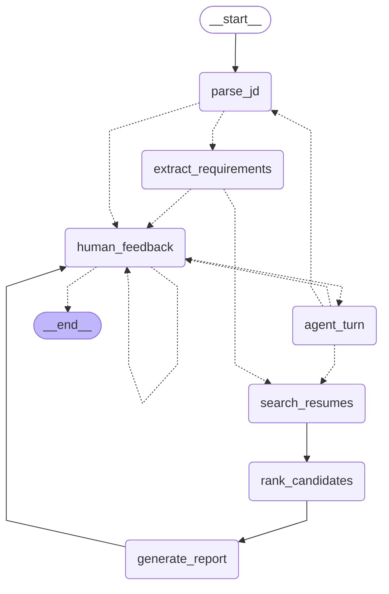

# State machine

Generated from the compiled LangGraph graph by `python matching_agent.py --diagram`; do not edit by hand. Dashed edges are conditional: the node's result decides which one is taken.

